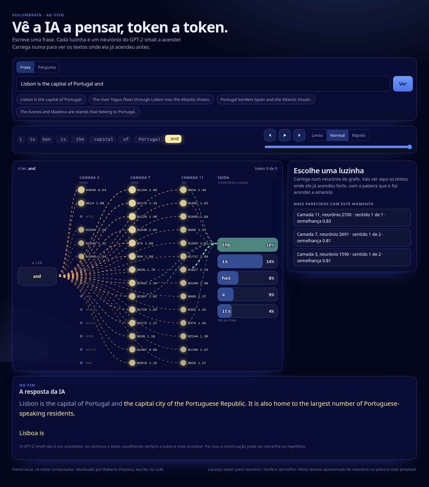

# VislumBrain

**Vê a IA por dentro e percebe porque é que uma resposta bem escrita não é o mesmo que uma resposta certa.**



O VislumBrain é uma ferramenta livre (licença MIT) de **literacia em IA**, para formadores, professores e estudantes. Mostra, num painel animado, o interior de uma IA pequena a ler uma frase. E deixa treiná-la com um texto teu, para ver uma coisa que surpreende muita gente: **ela repete o texto, mas não o percebe.**

## O que as pessoas levam de uma sessão

- **A IA deixa de ser magia.** Vêem-na a ler pedaço a pedaço, com dezenas de milhares de pequenas peças a acender, e passam a perguntar "porquê?" em vez de "como é possível?".
- **Escrever bem não é saber.** A IA completa frases com toda a confiança, mesmo quando está errada. Treinam-na com um texto vosso e vêem isto acontecer à frente de todos.
- **Confirmar numa fonte torna-se um hábito.** Saem com uma regra simples para usar IA: o que ela diz sobre factos, confirma-se.

## Para quem é

Para quem forma, ensina ou apresenta e quer um exemplo concreto e visual, em vez de mais um diapositivo. **Não precisas de saber programar**: copias uma linha, esperas uns minutos e abres uma página no browser. Tudo corre no teu computador e o texto que usares não sai dele.

## Instalar

Precisas de **Python 3.11 ou mais recente**, de internet e de uns 3 GB livres no disco. A instalação demora uns minutos, quase sempre à espera de descargas. Prepara-a **antes** da sala, com tempo.

**Windows.** Abre o PowerShell e cola esta linha:

```powershell
irm https://raw.githubusercontent.com/epestana28/VislumBrain/main/install.ps1 | iex
```

Se não tens Python, instala-o com `winget install Python.Python.3.12`, abre um PowerShell novo e cola a linha outra vez.

**Linux ou macOS.** Abre o terminal e cola esta linha (precisa de `git`):

```bash
curl -fsSL https://raw.githubusercontent.com/epestana28/VislumBrain/main/install.sh | bash
```

Foi testado em **Linux** e em **Windows 11** (PowerShell 5.1, em português): instalação, testes e painel a responder. O Windows 10 usa o mesmo PowerShell e deve funcionar, mas não o testámos. No macOS também deve funcionar, mas ainda não foi testado. Se algo falhar, abre uma pergunta na página de [Issues](https://github.com/epestana28/VislumBrain/issues) com a mensagem de erro e diz-nos o teu sistema. Mais pormenores no [guia de utilização](docs/USO.md#instalar-com-mais-pormenor).

## Abrir o painel

Windows (PowerShell):

```powershell
cd VislumBrain
.\vislumbrain.cmd serve --tag base
```

Linux ou macOS:

```bash
cd VislumBrain
./vislumbrain serve --tag base
```

Depois abre no browser **http://127.0.0.1:8765**, escreve uma frase **em inglês** (o modelo só percebe bem inglês) e carrega em **Ver**. Vês a frase a avançar e as luzinhas a acender. Para parar, carrega em Ctrl+C no terminal. O painel só funciona neste computador. **O arranque demora um pouco**, porque carrega dois modelos: espera pela linha que diz `painel: http://127.0.0.1:8765`.

**Velocidade.** Depende muito do computador. Num PC com 16 núcleos, cada frase demora uns 2 segundos. Num Windows 11 de teste com só 2 núcleos e 4 GB de memória funcionou, mas cada frase demorou cerca de 75 segundos. Para a sala, usa o computador mais forte que tiveres e experimenta antes.

## Levar para a sala

Há três versões, conforme o tempo que tens. Todas acabam na mesma pergunta: **"como confirmo uma resposta de uma IA?"**

| Tempo | O que fazes | Prepara antes |
|---|---|---|
| **5 minutos** | Mostras o painel e uma pergunta ao modelo original | Testar as tuas frases |
| **10 minutos** | Comparas o modelo original com um treinado com um texto teu | Treinar (cerca de 20 minutos) |
| **40 minutos** | A sessão completa, com votação da sala e discussão | O mesmo, mais uma folha de perguntas |

Tudo passo a passo no [guia de sala](docs/GUIA-DE-SALA.md). Como treinar a IA com um texto teu está no [guia de utilização](docs/USO.md#o-corpus-o-que-é-e-para-que-serve).

## O que isto não é

- O GPT-2 small é um modelo **pequeno e antigo**. Mostra como estes modelos funcionam e onde falham, mas não explica por si só o ChatGPT nem o Claude, que são muito maiores.
- Ver uma luzinha acender mostra **onde** o neurónio reage, não **o que ele significa**.
- Não é a primeira ferramenta para espreitar modelos de linguagem. Para ir mais fundo, recomendamos o [Neuronpedia](https://www.neuronpedia.org), uma plataforma de interpretabilidade muito robusta. O VislumBrain vai no mesmo sentido, de forma simplificada para formadores e estudantes.

## Saber mais

- [Guia de sala](docs/GUIA-DE-SALA.md): como apresentar, em 5, 10 ou 40 minutos.
- [Guia de utilização](docs/USO.md): instalação, comandos e o que cada parte faz.
- [Fontes e limites](docs/CIENCIA.md): para quem quer conferir o que está por trás e o que o projecto não afirma.

## Licença e créditos

Código sob licença MIT (ver `LICENSE`). O GPT-2 small (`openai-community/gpt2`) também tem licença MIT. Idealizado por Roberto Pestana, escrito via LLM.
